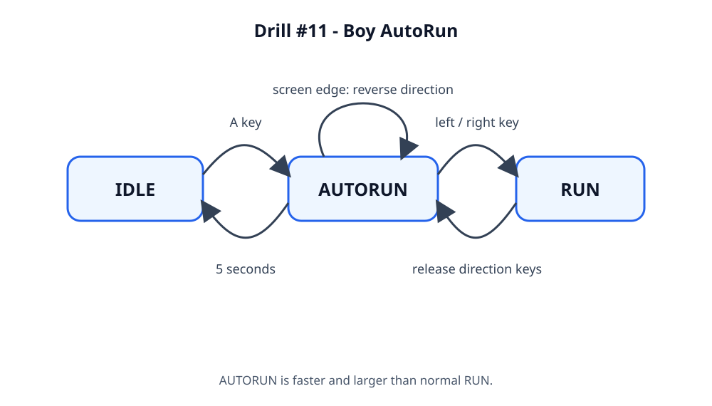

# Drill #11 - Boy AutoRun

## Overview

Add an automatic, temporarily invulnerable run mode to the boy character. The
feature is activated from `IDLE` and is implemented by a dedicated `AutoRun`
state class.

## Requirements

1. Pressing `A` while the boy is in `IDLE` enters `AUTORUN`.
2. In `AUTORUN`, the boy moves continuously without directional input.
3. The boy moves faster and is drawn larger in `AUTORUN` than in normal `RUN`.
4. At either horizontal screen edge, `AUTORUN` reverses direction and keeps
   moving within the screen.
5. After five seconds in `AUTORUN`, the boy returns to `IDLE`.
6. Pressing a left or right arrow during `AUTORUN` cancels automatic running
   and enters normal `RUN` in the pressed direction.
7. Normal `RUN` moves in the direction held by the player and returns to
   `IDLE` when neither horizontal direction key is held.
8. Add an `AutoRun` state class; do not implement this feature as only a
   direction-key check in the game loop.
9. Include the state diagram image in the submitted repository.

## State and Input Design

- `IDLE` + `A` -> `AUTORUN`
- `IDLE` + left/right arrow -> `RUN`
- `RUN` + release all horizontal direction keys -> `IDLE`
- `AUTORUN` + five seconds elapsed -> `IDLE`
- `AUTORUN` + left/right arrow -> `RUN` in the pressed direction
- `AUTORUN` reaching either screen edge -> reverse direction and remain in
  `AUTORUN`

The existing controller's other behavior is retained unless it conflicts with
these requirements.

## Acceptance Criteria

- `A` starts automatic movement only from `IDLE`.
- Automatic movement needs no held direction key.
- AutoRun speed is greater than normal Run speed and its rendered size is
  larger than normal.
- AutoRun reverses at both screen edges without moving off-screen.
- AutoRun ends after five seconds and returns to `IDLE`.
- A direction key interrupts AutoRun and starts normal `RUN` toward that side.
- The state diagram is present as an image file and linked below.

## State Diagram

